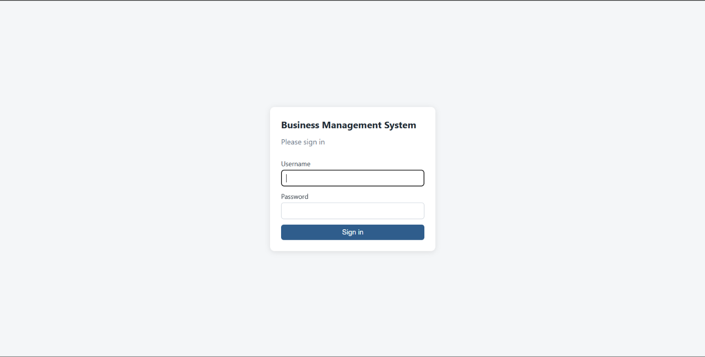
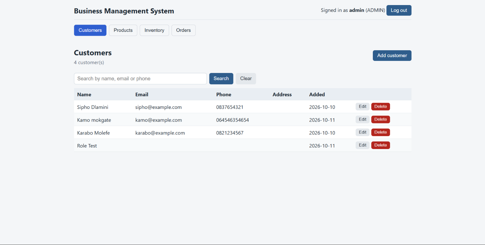
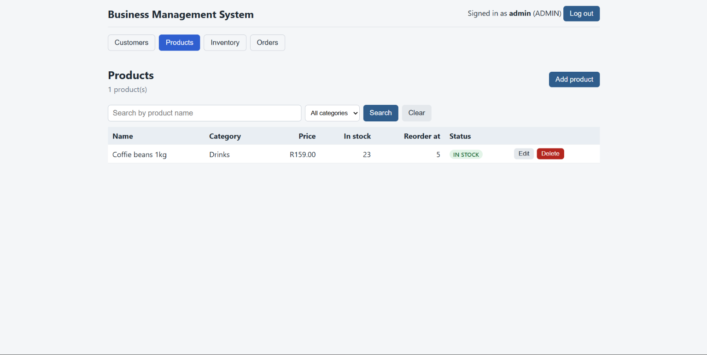
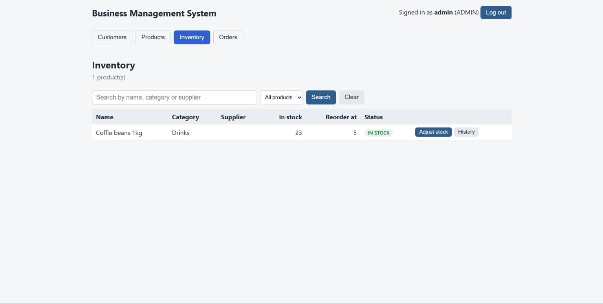
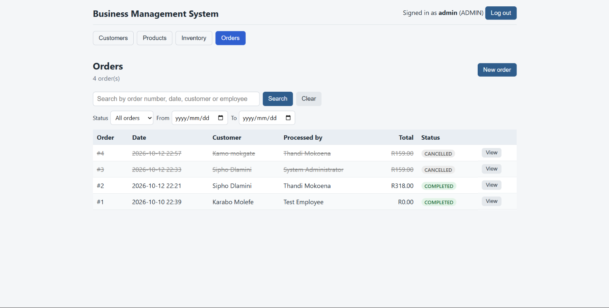
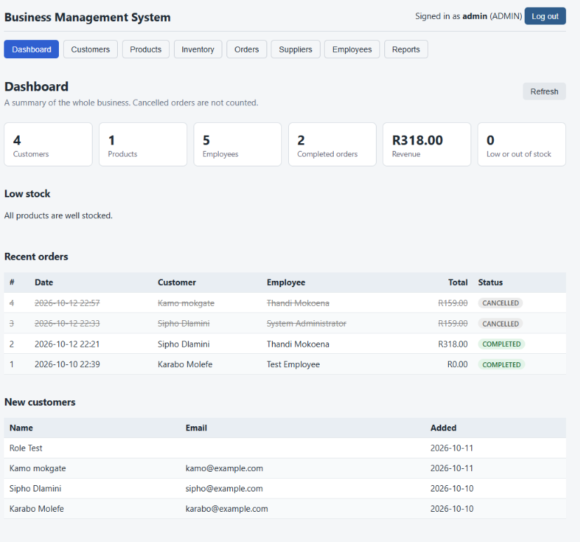
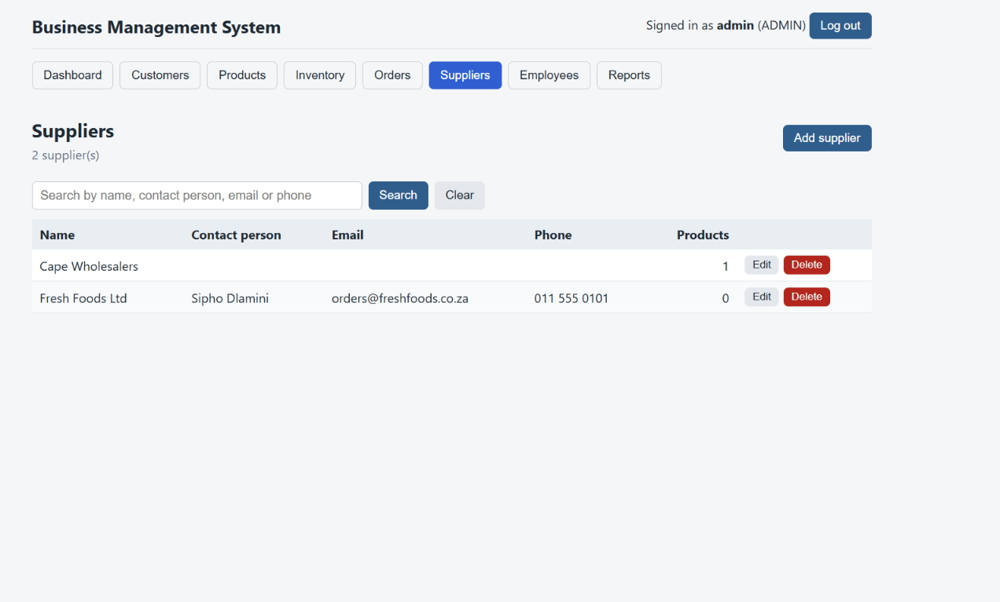
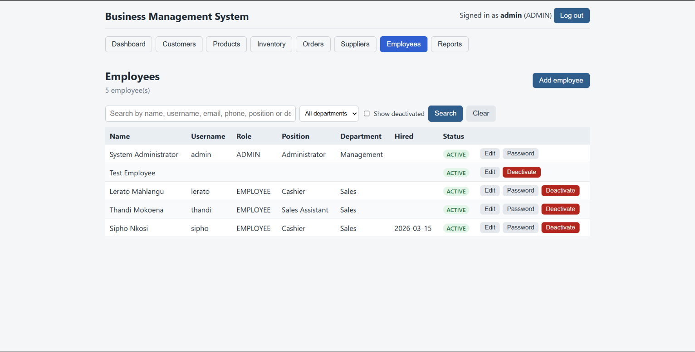
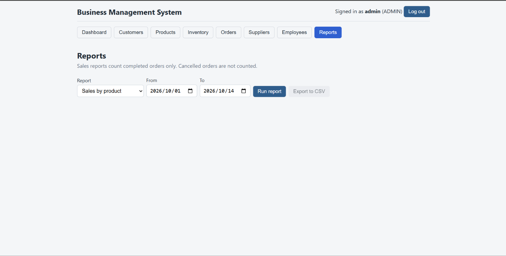

# Business Management System - Version 2 (web)

A web version of my Version 1 desktop application (`business-management-system`, Java Swing + SQLite),
rebuilt step by step with **React**, **Spring Boot** and **PostgreSQL**. It is a learning and portfolio
project for a small business: customers, products, suppliers, stock, orders, employees and reports, with an
administrator and an employee role.

> **Status: work in progress.** The parts listed under "What works today" were tested by hand in the
> browser and with PowerShell. The parts under "Not done yet" do not exist. There are no automated tests yet.

## Screenshots

| Login | Customers |
|---|---|
|  |  |

| Products | Inventory |
|---|---|
|  |  |

| Orders | Dashboard |
|---|---|
|  |  |

| Suppliers | Employees |
|---|---|
|  |  |

| Reports |
|---|
|  |

## What works today

- **Login and roles**: administrator and employee. The server checks the role on every request, not only the screen.
- **Customers**: list, search (name, email, phone), add, edit, delete (administrator only; a customer with orders cannot be deleted).
- **Products**: list, search by name, filter by category, add, edit, delete. Only the administrator can change products. Prices are stored in cents.
- **Inventory**: stock list with status (IN STOCK, LOW STOCK, OUT OF STOCK), search and status filter; the administrator can add or remove stock with a required reason; every change is kept in a history. Stock can never go below 0.
- **Orders**: create an order (customer plus product lines, total shown while building), list with search, status and date filters, view the lines with the prices at the time of sale. The administrator can cancel an order, which puts the stock back. An employee sees only the orders they processed.
- **Dashboard**: the first screen after login. The administrator sees customer, product, employee and order counts, revenue, low-stock products, recent orders and new customers. An employee sees a limited view with only their own recent orders (the server decides, not the screen).
- **Suppliers** (administrator only): list, search, add, edit, delete; a supplier that still provides active products cannot be deleted. A product can be linked to a supplier.
- **Employees** (administrator only): add an employee together with their login, edit details and role, reset a password, deactivate and reactivate. Deactivating blocks the login but keeps the history. An administrator cannot deactivate or change the role of their own account, so one active administrator always remains.
- **Reports** (administrator only): sales by product, employee, customer and day (completed orders in a date range, cancelled orders not counted), stock levels and value, and low stock. Any report can be exported to CSV.
- Every rule is checked on the **server** and answered with a readable message (for example "Only 3 in stock for ...").

## Not done yet

- A settings screen and a backup button (the currency symbol is read from the settings table but cannot be changed in the app)
- Automated tests
- HTTPS and token (JWT) login: see "Security notes"
- The orders list shows at most the newest 1,000 orders

## Technology

| Part | Choice |
|---|---|
| Front end | React (JavaScript) with Vite |
| Backend | Java 17 target, Spring Boot 4.1 (Spring Web, Spring Data JPA, Spring Security, JdbcTemplate) |
| Database | PostgreSQL 18 |
| Build | Maven (the included `mvnw` wrapper) and npm |

## How to run it

You need Java, Node.js and PostgreSQL installed.

1. Create an empty PostgreSQL database called `bms`.
2. Run `database/postgres-schema.sql` in it (pgAdmin: Query Tool, open file, F5).
3. Start the backend. The database password is read from an environment variable and is never stored in a file:
   ```
   cd backend
   $env:DB_PASSWORD="your-postgres-password"
   .\mvnw.cmd spring-boot:run
   ```
   On the first start, when there are no users yet, two demo accounts are created.
4. Start the front end in a second terminal:
   ```
   cd frontend
   npm install
   npm run dev
   ```
5. Open http://localhost:5173 and log in.

Demo accounts (created automatically, **for local testing only**):

| User | Password | Role |
|---|---|---|
| admin | Admin@123 | Administrator |
| thandi | Employee@123 | Employee |

## Security notes

- Login uses HTTP Basic authentication with BCrypt-hashed passwords, no sessions and no cookies. That is simple, but it is only safe over HTTPS, and the passwords above are public, so **do not expose this app to a network as it is**. A real system would use HTTPS and a token (JWT). That is a possible next step.
- The browser keeps the login in memory only, so reloading the page logs you out.
- The database password is only ever read from the `DB_PASSWORD` environment variable.

## Design decisions

- **Layers**: screen (React) calls the API; controller, service (rules), repository (database). Rules live in the service, never in the screen.
- **Money in cents** (whole numbers) so there are no rounding errors; the price on an order line is copied at the time of sale, so later price changes do not alter old orders.
- **Soft delete**: customers, products and suppliers are hidden, not erased, and employees are deactivated, so order history stays complete.
- **Transactions**: creating or cancelling an order changes the order, its lines, the stock and the stock history together, or not at all.
- **Safe stock changes**: stock is changed with one SQL statement that refuses to go below 0, so two people working at the same moment cannot corrupt it.
- **The server decides**: totals and prices are calculated on the server; the browser only sends product numbers and quantities. Who may call which part of the API (for example suppliers, employees and reports are administrator only) is set in one place, `SecurityConfig`.

## Folder structure

```
database/     PostgreSQL schema script (9 tables, 15 indexes, 3 views)
backend/      Spring Boot project
  src/main/java/com/bms/backend/
    auth/        users, login, first-start demo accounts
    config/      security rules (who may call what)
    common/      shared exceptions and error answers
    customer/    customers
    product/     products
    inventory/   stock list, history, adjustments
    orders/      orders: create, list, view, cancel
    supplier/    suppliers
    employee/    employees and their logins
    report/      reports (read-only)
    dashboard/   dashboard figures
frontend/     React project (src/ holds one file per screen or form)
docs/screenshots/   pictures used in this README
```
